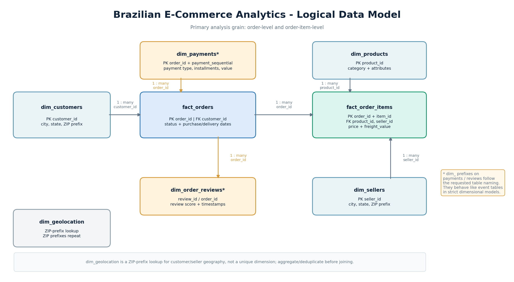
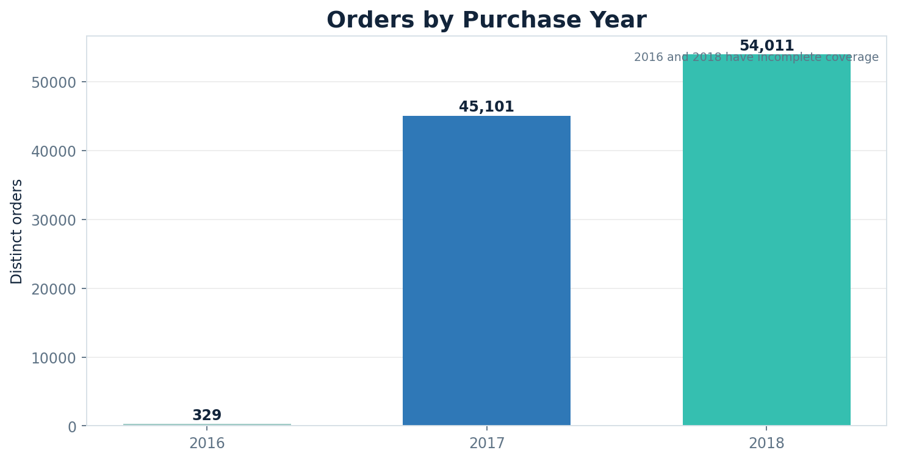
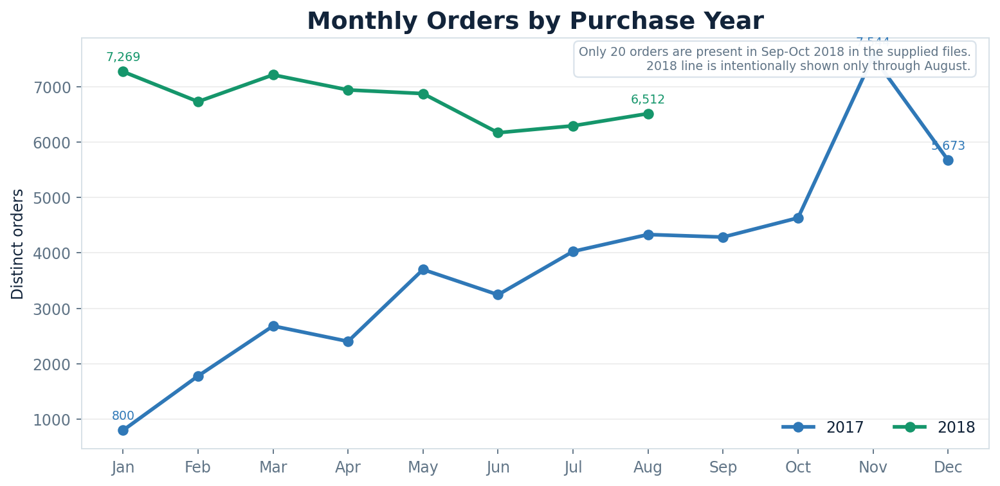
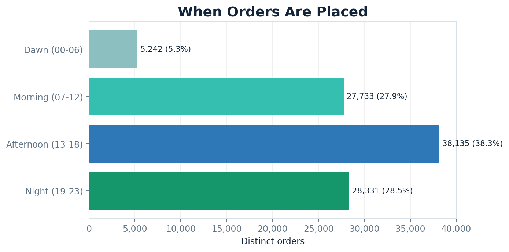
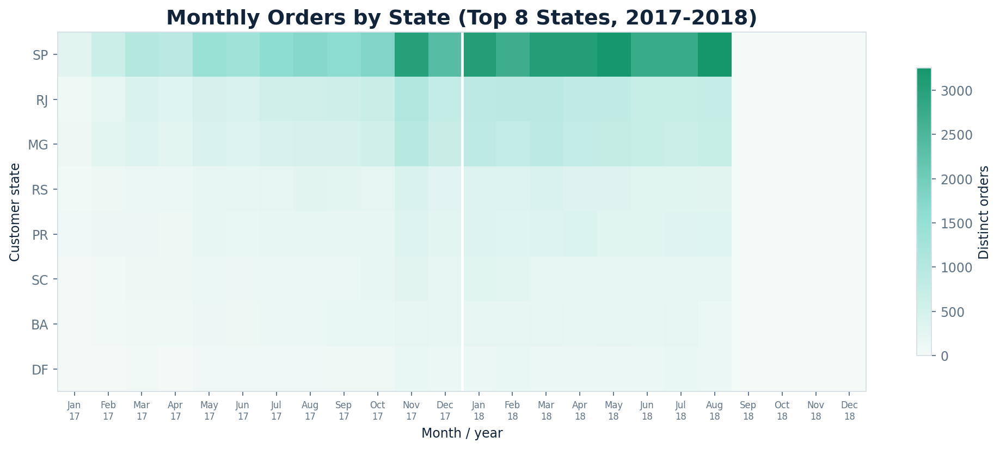
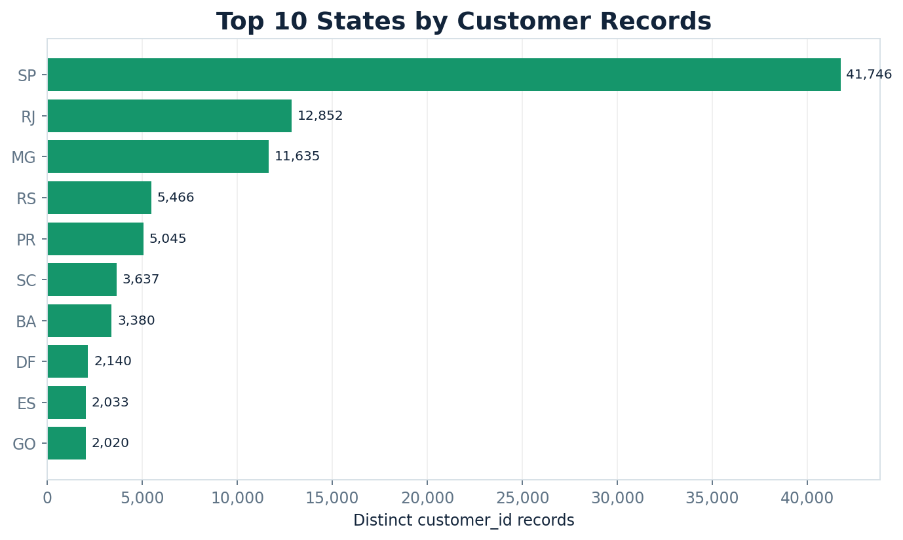
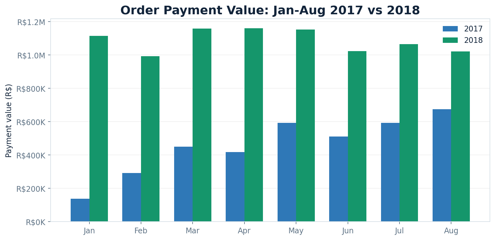
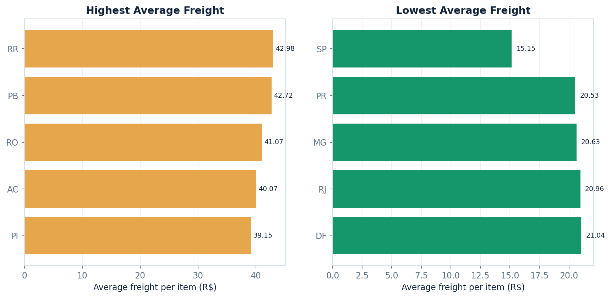
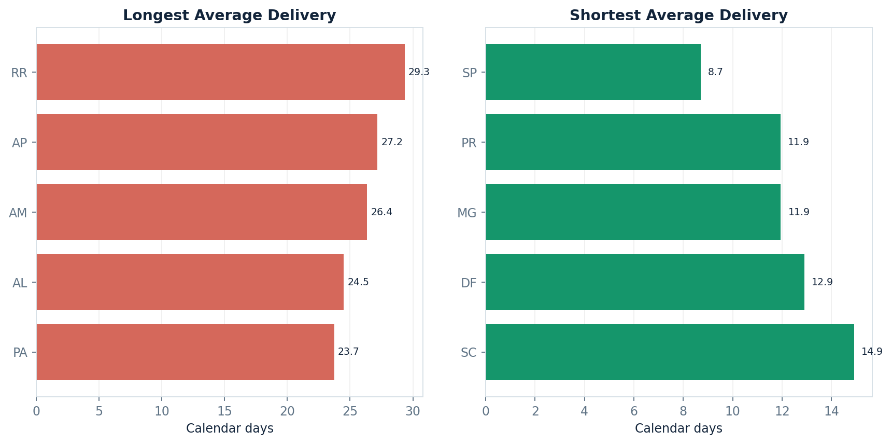
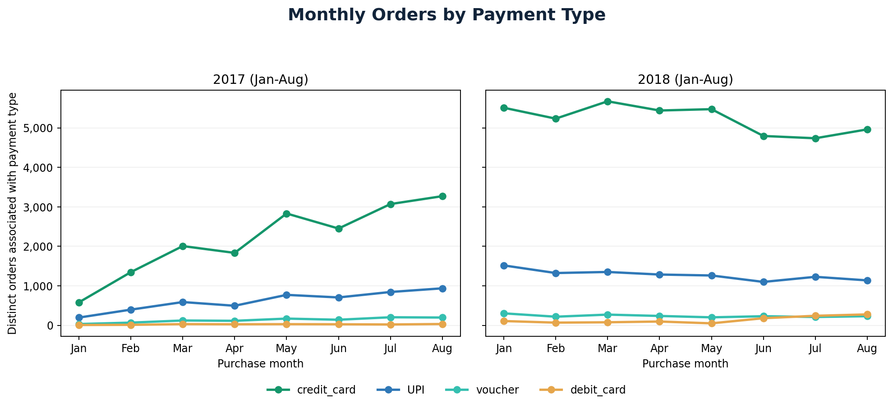

# Brazilian E-Commerce Analytics: Orders, Payments, Freight & Delivery Performance using SQL

**An independent SQL portfolio project using the Brazilian E-Commerce Public Dataset by Olist.**

The analysis explores purchase trends, customer geography, payment behavior, item-price value, freight costs, and delivery performance. The repository contains the problem statement, original analysis requests, six supplemental questions, a logical data model, SQL queries, and result visuals.

> **Project scope note:** This is an independent portfolio exercise using public Olist data. It is not a Target work assignment and does not use Target internal data.

## Key findings at a glance

| Metric | Result from the supplied CSV files |
|---|---:|
| Orders | 99,441 |
| Order items | 112,650 |
| Payment rows | 103,886 |
| Customer records | 99,441 |
| Distinct customer cities / state codes | 4,119 / 27 |
| Purchase timestamp range | 2016-09-04 to 2018-10-17 |
| Jan-Aug payment value, 2017 | R$ 3,669,022.12 |
| Jan-Aug payment value, 2018 | R$ 8,694,733.84 |
| Jan-Aug payment-value growth, 2017 to 2018 | **+136.98%** |
| Average calendar-day delivery time for orders with a delivered timestamp | 12.50 days |
| Orders delivered before their estimated date (calendar-date comparison) | 91.89% |
| Average review score | 4.09 / 5 |

## Contents

- [Dataset and methodology](#dataset-and-methodology)
- [Data model](#data-model)
- [analysis requests and findings](#analysis-requests-and-findings)
- [SQL techniques](#sql-techniques)
- [Limitations and validation notes](#limitations-and-validation-notes)

## Dataset and methodology

The analysis was calculated from the uploaded CSV files. The totals below are the row counts in those files, not counts inferred from a dashboard. Dataset reference: [Brazilian E-Commerce Public Dataset by Olist on Kaggle](https://www.kaggle.com/datasets/olistbr/brazilian-ecommerce).

| File | Rows | Main use |
|---|---:|---|
| `orders.csv` | 99,441 | Order status, purchase and delivery timestamps |
| `order_items.csv` | 112,650 | Item prices, freight, product and seller keys |
| `payments.csv` | 103,886 | Payment type, installment count and payment value |
| `customers.csv` | 99,441 | Customer city, state and ZIP prefix |
| `order_reviews.csv` | 99,224 | Review score and review timestamps |
| `products.csv` | 32,951 | Product category and physical attributes |
| `sellers.csv` | 3,095 | Seller location and seller key |
| `geolocation.csv` | 1,000,163 | ZIP-prefix lookup; repeated prefixes are present |

**Purchase coverage:** `2016-09-04 21:15:19` through `2018-10-17 17:30:18`.

**Calculation conventions used:**

- Count orders with `COUNT(DISTINCT order_id)` where the business question asks for orders.
- `SUM(price)` / `AVG(price)` and `SUM(freight_value)` / `AVG(freight_value)` are order-item-level calculations.
- `payment_value` is aggregated from payment rows, using the order's purchase timestamp to assign year and month.
- Delivery calculations use calendar-date differences, matching the date-based SQL approach used in this project. For variance, `actual delivery date - estimated delivery date` is used: negative = early, zero = on time, positive = late.
- Hour bands used for the time-of-day analysis follow the supplied problem statement: 00-06 Dawn, 07-12 Morning, 13-18 Afternoon, 19-23 Night.

## Data model

### Core join paths

| Parent | Child | Relationship / use |
|---|---|---|
| `dim_customers.customer_id` | `fact_orders.customer_id` | One customer record to many orders |
| `fact_orders.order_id` | `fact_order_items.order_id` | One order to one or more items |
| `dim_products.product_id` | `fact_order_items.product_id` | One product to many order-item rows |
| `dim_sellers.seller_id` | `fact_order_items.seller_id` | One seller to many order-item rows |
| `fact_orders.order_id` | `dim_payments.order_id` | One order can have multiple payment-sequence rows |
| `fact_orders.order_id` | `dim_order_reviews.order_id` | Review records are linked to orders; validate cardinality |
| ZIP-prefix lookup | `dim_geolocation` | ZIP prefixes repeat, so aggregate/deduplicate before joining |

The names `dim_payments` and `dim_order_reviews` follow the requested `dim_` naming convention. In strict dimensional modelling, payments and reviews behave more like transaction/event tables. Joining raw `fact_order_items` and raw payment rows together can multiply rows and overstate amounts; aggregate each grain separately.

## analysis requests and findings

The following 17 questions preserve the intent of the provided problem statement, framed for the Olist dataset.

### 1. Exploratory data analysis

**Q1. What are the data types of the customer table columns?**

The source CSV columns were inferred as follows during profiling. The recommended SQL schema stores ZIP prefixes as `CHAR(5)` instead of an integer to protect leading zeros.

| Column | Source-inferred type | Recommended database type / note |
|---|---|---|
| `customer_id` | String | `CHAR(32)` |
| `customer_unique_id` | String | `CHAR(32)` |
| `customer_zip_code_prefix` | Integer | `CHAR(5)` to preserve prefix formatting |
| `customer_city` | String | `VARCHAR(100)` |
| `customer_state` | String | `CHAR(2)` |

**Q2. What is the purchase timestamp range?**

Purchases run from **4 September 2016** through **17 October 2018**. The coverage is not a clean set of three full calendar years.

**Q3. How many customer cities and state codes are represented?**

The data contains **4,119 distinct customer cities** and **27 state codes**.

### 2. Order trends and time-of-day behavior

**Q4. Is the number of orders growing over the years?**

| Purchase year | Orders | Year-over-year growth |
|---:|---:|---:|
| 2016 | 329 | — |
| 2017 | 45,101 | +13,608.51% vs 2016 |
| 2018 | 54,011 | +19.76% vs 2017 |

2016 only has 329 orders in this extract, making the 2017 percentage increase an unsuitable like-for-like comparison. A fairer Jan-Aug comparison is **22,968 orders in 2017 vs 53,991 in 2018, up 135.07%**. The supplied 2018 file contains just 20 orders for September and October combined, so the apparent year-end drop should be treated as a coverage limitation, not evidence of demand collapse.

**Q5. Is there monthly seasonality in the number of orders?**

When months are combined across all available years, the highest counts are **August: 10,843**, **May: 10,573**, and **July: 10,318**. In 2017, November is the peak month with **7,544 orders**; January has **800**. Because years are incomplete and source coverage differs by month, this is a signal for further testing rather than proof of recurring seasonality.

**Q6. At what time of day do customers mostly place orders?**

| Time band | Orders | Share |
|---|---:|---:|
| Afternoon (13-18) | 38,135 | 38.35% |
| Night (19-23) | 28,331 | 28.49% |
| Morning (07-12) | 27,733 | 27.89% |
| Dawn (00-06) | 5,242 | 5.27% |

Afternoon is the largest group, representing **38.35%** of orders under the stated hour-band definition.

### 3. Evolution of e-commerce orders across Brazil

**Q7. What is the month-on-month number of orders in each state?**

The SQL output groups distinct orders by `customer_state`, `year`, and `month`, and the visual below highlights monthly differences among the eight largest order-volume states. SP is the largest state with **41,746 orders**, followed by RJ (**12,852**) and MG (**11,635**). Keep the year in the grouping; a month number alone would combine January from different years.

**Q8. How are customer records distributed across states?**

| State | Customer records | Share of customer records |
|---|---:|---:|
| SP | 41,746 | 41.98% |
| RJ | 12,852 | 12.92% |
| MG | 11,635 | 11.70% |
| RS | 5,466 | 5.50% |
| PR | 5,045 | 5.07% |

The top three state codes represent **66.60%** of customer records. These are `customer_id` records in the supplied customers table; `customer_unique_id` is a separate identifier and can repeat across order-specific customer records.

### 4. Impact on the economy: payment value, price and freight

**Q9. What is the percentage increase in order payment value from 2017 to 2018 for January-August only?**

| Period | Total payment value |
|---|---:|
| January-August 2017 | R$ 3,669,022.12 |
| January-August 2018 | R$ 8,694,733.84 |
| **Increase** | **R$ 5,025,711.72 (+136.98%)** |

Monthly comparison:

| Month | Payment value 2017 | Payment value 2018 | Growth |
|---|---:|---:|---:|
| Jan | R$ 138,488.04 | R$ 1,115,004.18 | 705.13% |
| Feb | R$ 291,908.01 | R$ 992,463.34 | 239.99% |
| Mar | R$ 449,863.60 | R$ 1,159,652.12 | 157.78% |
| Apr | R$ 417,788.03 | R$ 1,160,785.48 | 177.84% |
| May | R$ 592,918.82 | R$ 1,153,982.15 | 94.63% |
| Jun | R$ 511,276.38 | R$ 1,023,880.50 | 100.26% |
| Jul | R$ 592,382.92 | R$ 1,066,540.75 | 80.04% |
| Aug | R$ 674,396.32 | R$ 1,022,425.32 | 51.61% |

**Q10. What are total and average order-item prices by state?**

| State | Total item price | Average item price |
|---|---:|---:|
| SP | R$ 5,202,955.05 | R$ 109.65 |
| RJ | R$ 1,824,092.67 | R$ 125.12 |
| MG | R$ 1,585,308.03 | R$ 120.75 |
| RS | R$ 750,304.02 | R$ 120.34 |
| PR | R$ 683,083.76 | R$ 119.00 |

These totals aggregate `price` over item rows associated with customer state. `AVG(price)` is the average **item price**, not average order value.

**Q11. What are total and average freight values by state?**

SP has the largest total freight value (**R$ 718,723.07**) and a lower average freight per item (**R$ 15.15**) because the state has far more item rows. RR has the highest average freight per item (**R$ 42.98**) but only **R$ 2,235.19** total freight across 52 item rows.

### 5. Sales, freight and delivery performance

**Q12. Calculate time to deliver and the estimated-versus-actual date difference in one query.**

For the **96,476 orders with a delivered-customer timestamp**, average calendar-day delivery time is **12.50 days** and median delivery time is **10 days**. Using `actual date - estimated date`, the mean difference is **-11.88 days**, meaning actual delivery was earlier than the estimate on average. Orders without actual delivery timestamps are excluded from this calculation.

**Q13. Which states have the highest and lowest average freight value?**

| Highest average freight | Average freight / item | Lowest average freight | Average freight / item |
|---|---:|---|---:|
| RR | R$ 42.98 | SP | R$ 15.15 |
| PB | R$ 42.72 | PR | R$ 20.53 |
| RO | R$ 41.07 | MG | R$ 20.63 |
| AC | R$ 40.07 | RJ | R$ 20.96 |
| PI | R$ 39.15 | DF | R$ 21.04 |

**Q14. Which states have the highest and lowest average delivery times?**

| Longest average delivery | Average days | Delivered orders | Shortest average delivery | Average days | Delivered orders |
|---|---:|---:|---|---:|---:|
| RR | 29.34 | 41 | SP | 8.70 | 40,495 |
| AP | 27.18 | 67 | PR | 11.94 | 4,923 |
| AM | 26.36 | 145 | MG | 11.95 | 11,355 |
| AL | 24.50 | 397 | DF | 12.90 | 2,080 |
| PA | 23.73 | 946 | SC | 14.91 | 3,547 |

Small states have far fewer delivered orders, so state rankings should be read alongside sample size. SP has the shortest average delivery time among these states and the largest sample.

**Q15. Which states deliver earliest relative to the estimated delivery date?**

This uses average `actual delivery date - estimated delivery date`; a more negative value means more days early.

| State | Average actual-minus-estimated days | Delivered orders |
|---|---:|---:|
| AC | -20.73 | 80 |
| RO | -20.10 | 243 |
| AP | -19.69 | 67 |
| AM | -19.57 | 145 |
| RR | -17.29 | 41 |

The states listed have the most negative average date difference. Their sample sizes are much smaller than SP or RJ, so this is a descriptive ranking and not proof that every shipment in those states is faster.

### 6. Payment behavior

**Q16. What is the month-on-month number of orders by payment type?**

The SQL returns counts by purchase year, month, and each payment type. Over the full supplied file, the leading observed types by distinct orders are:

| Observed payment type | Distinct orders associated with type | Total payment value |
|---|---:|---:|
| `credit_card` | 76,505 | R$ 12,542,084.19 |
| `UPI` | 19,784 | R$ 2,869,361.27 |
| `voucher` | 3,866 | R$ 379,436.87 |
| `debit_card` | 1,528 | R$ 217,989.79 |
| `not_defined` | 3 | R$ 0.00 |

Counts by type are not necessarily mutually exclusive because one order can have multiple payment rows. The labels above mirror the uploaded file, including `UPI`.

The monthly chart compares January-August 2017 and 2018 separately to avoid presenting the sparse late-2018 records as a real demand pattern.

**Q17. How many orders are associated with each payment-installment count?**

| Installments | Distinct orders |
|---:|---:|
| 1 | 49,060 |
| 2 | 12,389 |
| 3 | 10,443 |
| 4 | 7,088 |
| 10 | 5,315 |
| 5 | 5,234 |
| 8 | 4,253 |
| 6 | 3,916 |

## SQL techniques

- Multi-table joins across orders, customers, items, products and payments
- `COUNT(DISTINCT ...)`, `SUM`, `AVG`, `ROUND`, and percentage calculations
- `EXTRACT`, `DATE_DIFF`, time-of-day `CASE` groups and date-range filters
- CTEs for reusable year/month payment calculations
- `LAG()` for year-over-year comparisons
- `PIVOT` / conditional aggregation for payment-type comparisons
- Data-grain validation and one-to-many join checks

## Limitations and validation notes

1. **Year coverage:** The purchase range runs from September 2016 through October 2018, but the supplied file has only 20 orders in September-October 2018 combined. Compare Jan-Aug 2017 with Jan-Aug 2018 where possible and do not interpret the sparse late-2018 values as a confirmed demand collapse.
2. **Delivery timestamps:** Orders without an actual delivered-customer timestamp are excluded from delivery duration and actual-versus-estimated analysis.
3. **Grain / double-counting:** `order_items.csv` contains 112,650 rows and `payments.csv` contains 103,886 rows for 99,441 orders. Joining the raw tables together can multiply rows. Aggregate each measure at its natural grain first.
4. **ZIP prefixes:** `customer_zip_code_prefix` may be inferred as an integer by a CSV reader. Store it as a five-character string if leading zeros must be preserved. Geolocation ZIP prefixes repeat and should not be treated as a unique key.
5. **Product category header:** In the uploaded products CSV the source header is `product category` (space included). Map it to `product_category` during import. No separate category-translation CSV was included.
6. **Payment types:** The values shown above mirror the uploaded payments CSV. The file contains `UPI`; use actual `SELECT DISTINCT payment_type` output when validating other copies of the dataset.
7. **SQL dialect:** `sql/olist_analysis_queries_bigquery.sql` uses BigQuery Standard SQL. `sql/ecommerce_db_schema_mysql.sql` is the MySQL 8 DDL version of the requested table structure; some query functions such as `PIVOT` and `SAFE_DIVIDE` need adaptation to run in MySQL Workbench.

## Documentation PDFs

- [Project problem statement](docs/problem_statement.pdf)
- [Ad-hoc data analysis questions (17 original + 6 supplemental)](docs/adhoc_data_analysis_questions.pdf)
- [Logical data model](docs/data_model.pdf)
